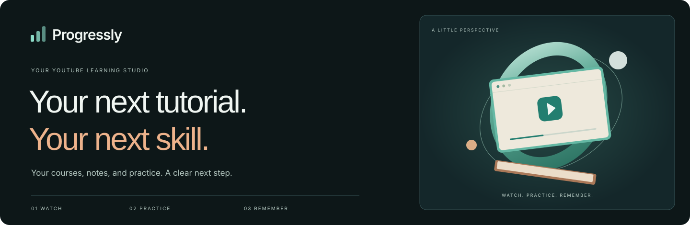
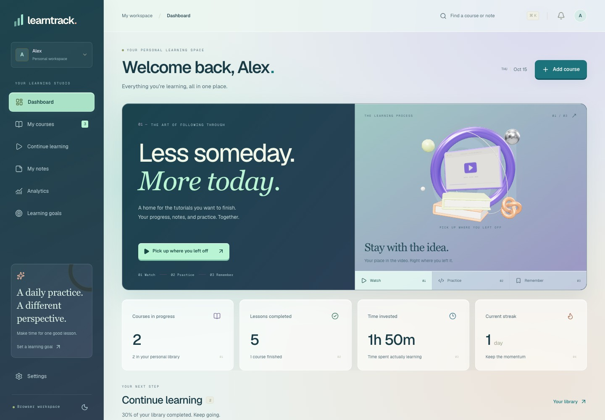
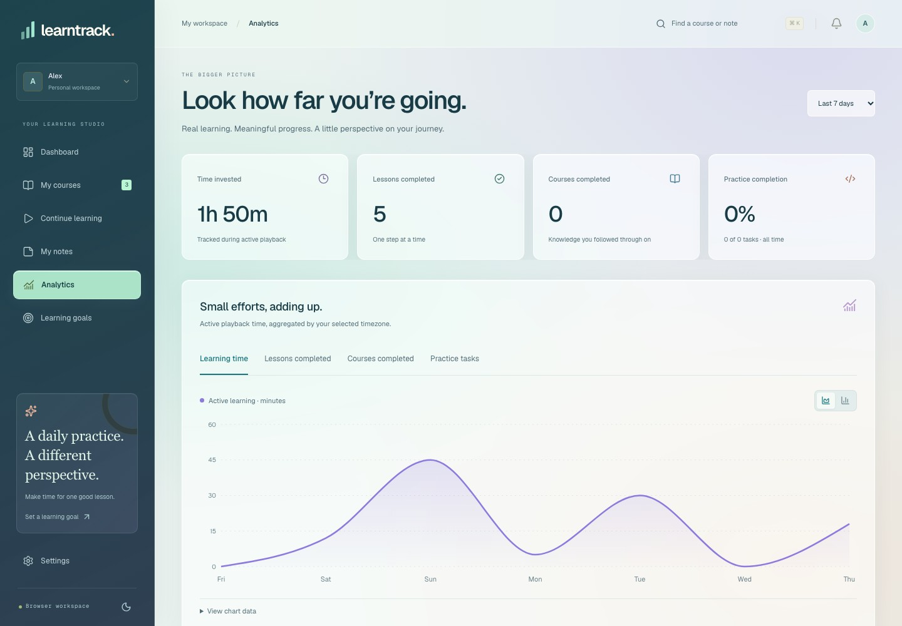

<p align="center">
  
</p>

# LearnTrack

### Stop collecting tutorials. Start completing them.

A personal learning studio that turns YouTube playlists into a course you can actually finish. Keep your place, capture your thinking, practice what you learn, and see the small efforts adding up.

**[The experience](#the-experience) · [Product tour](#product-tour) · [Get started](#get-started) · [Developer guide](docs/DEVELOPMENT.md)**

## Curiosity deserves a little structure

You save a playlist. Watch a few lessons. Leave a note somewhere. A week later, you’re trying to remember where you stopped.

LearnTrack keeps the whole learning process together: the next video, the useful timestamp, the concept to practice, and the progress you’re making. Built for self-directed learners, tutorial makers, and anyone with a “watch later” list that deserves a little follow-through.

## The experience

| Bring the curiosity | Make it a practice | See yourself grow |
| :--- | :--- | :--- |
| Import a YouTube playlist or video, or build a course manually. Your lessons stay in order. | Resume your video, capture a note, bookmark an explanation, and try a practice task. | Follow actual learning time, completed lessons, course progress, and daily or weekly goals. |

## Product tour

### A workspace that makes the next step clear

Your courses, daily intention, learning activity, and a shortcut back to the lesson you left. An interactive Three.js showcase connects the three parts of learning: watch, practice, remember.



### Progress with a little perspective

Switch between area and bar charts. Explore lesson status in a donut chart, compare course progress, and find your most active weekdays. A Three.js timeline gives the last seven days a physical shape, with selectable days and minutes/lessons controls.



*Screenshots use an illustrative workspace created for the product tour. The application starts empty and displays your saved activity.*

### The details that help a lesson stick

| In your studio | What it does for you |
| :--- | :--- |
| **A personal course library** | Import playlists and individual videos. Search, filter, favorite, pause, archive, and refresh courses. |
| **A player that keeps your place** | Resume from your last saved position. Mark lessons complete when you’re ready, or opt into automatic completion at 90%. |
| **Notes beside the lesson** | Write Markdown, keep timestamped notes and bookmarks, and flag an idea for revision. |
| **Practice beyond watching** | Keep practice tasks with each lesson. Watching and doing have separate completion records. |
| **Goals that fit your day** | Set daily minute or lesson targets and weekly time goals. Follow streaks, a learning calendar, and course deadlines. |
| **Honest analytics** | Learning time comes from active playback, with timezone-aware daily records. Empty charts stay empty until you learn. |
| **A tactile interface** | Frosted glass surfaces in petrol, glacier mint, orchid, and apricot. Custom Three.js models, interactive views, light and dark themes, responsive layouts, and keyboard navigation. Reduced motion and WebGL fallback are supported. |

## Your workspace, your choice

**Start locally.** Without Supabase configured, courses, notes, tasks, goals, and preferences are saved in this browser. No account is needed. Manual course creation works without API credentials.

**Connect an account.** The application includes Supabase integration for email/password, Google sign-in, and saving across devices. Cloud mode needs the database schema and access policies described in the developer guide before it can be used.

Local data stays in its original browser; configuring cloud mode does not automatically upload it. Browser storage can be cleared by the browser or its user.

## Get started

You’ll need Node.js 22+ and Bun 1.4+.

```sh
bun install
cp .env.example .env.local
bun run dev
```

Open **[localhost:3000](http://localhost:3000)** for your workspace, or **[/welcome](http://localhost:3000/welcome)** for the public product page. If you already have `.env.local`, keep your existing file.

| Integration | Environment variables | Needed for |
| :--- | :--- | :--- |
| YouTube Data API v3 | `YOUTUBE_API_KEY` | Importing and refreshing public YouTube metadata. Keep this key server-side. |
| Supabase | `NEXT_PUBLIC_SUPABASE_URL`, `NEXT_PUBLIC_SUPABASE_PUBLISHABLE_KEY` | Accounts, Google sign-in, and cloud persistence. Requires the database schema; see cloud setup status below. |

**[Read the complete setup and deployment guide →](docs/DEVELOPMENT.md)**

## Built with care

Next.js 16 · React 19 · TypeScript · Three.js · Recharts · Supabase · PostgreSQL · Zustand · Tailwind CSS

One shared WebGL renderer draws the visible 3D scenes, caps pixel density, pauses in hidden tabs, and disposes removed models. Charts also have HTML legends or data tables, so the information remains usable without the artwork.

Domain behavior and database isolation are covered with Vitest and PGlite. Playwright checks the learning workflows and visual interactions on desktop and mobile. See [validation commands](docs/DEVELOPMENT.md#checks).

## A few things to know

- LearnTrack organizes and tracks learning; videos remain on YouTube and play through its embedded player.
- Private, deleted, and non-embeddable videos may be unavailable. Manual course creation remains available when imports cannot complete.
- Playback outside LearnTrack cannot be tracked. Final progress saves depend on browser and YouTube behavior.
- Cloud sign-in, email, OAuth, and deployment require your own service configuration. This repository does not provide a hosted LearnTrack service.
- **Cloud setup status:** this checkout is missing `supabase/migrations/001_learntrack.sql`, which the integration and database tests expect. Restore that migration before enabling cloud mode. Local mode does not depend on it.

---

**One link. A little time. Something you’ll be glad you started.**
